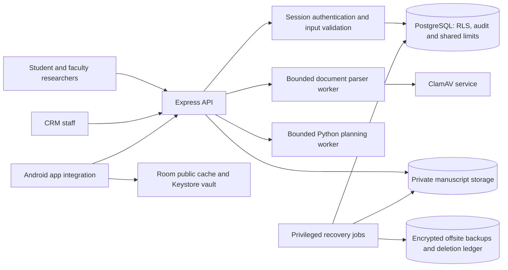

# IAS — Security Architecture, Controls, Risk Analysis and Verification

This is the main security reference for the **UMak Center for Research Management (CRM)** project. It explains what the system protects, how the controls work, where their implementations live, how to run them, and what the tests and measurements actually demonstrate. Like the [ALGOCOM reference](../algocom/README.md), it connects the design, implementation, evaluation and reproducible evidence in one place.

**Updated: 5 November 2026, Asia/Manila.** The current implementation is a synthetic-data Express/PostgreSQL backend with an Android security/cache library. It is not a deployed university platform. The latest saved local regression run contains **48 passing tests**, and the Android library, test APK and lint builds passed. Cloud deployment and Android device execution remain separate verification steps.

`README.md` is the conventional GitHub folder entry point: GitHub renders this guide when this directory is opened. Application code remains in its actual source folders; this directory holds the threat models, risk package and their documentation.

## Contents

- [1. Scope and current status](#1-scope-and-current-status)
- [2. Repository and implementation map](#2-repository-and-implementation-map)
- [3. Architecture and trust boundaries](#3-architecture-and-trust-boundaries)
- [4. Confidentiality controls](#4-confidentiality-controls)
- [5. Integrity controls](#5-integrity-controls)
- [6. Availability controls](#6-availability-controls)
- [7. Database schema and migrations](#7-database-schema-and-migrations)
- [8. API and authorization reference](#8-api-and-authorization-reference)
- [9. Local setup and configuration](#9-local-setup-and-configuration)
- [10. Tests and verification](#10-tests-and-verification)
- [11. Benchmarks and interpretation](#11-benchmarks-and-interpretation)
- [12. Demonstrations and defense walkthrough](#12-demonstrations-and-defense-walkthrough)
- [13. Threat modeling and risk analysis](#13-threat-modeling-and-risk-analysis)
- [14. Deployment and recovery operations](#14-deployment-and-recovery-operations)
- [15. Troubleshooting](#15-troubleshooting)
- [16. Remaining work and claim boundaries](#16-remaining-work-and-claim-boundaries)
- [17. Evidence, submissions and references](#17-evidence-submissions-and-references)

## 1. Scope and current status

The security work follows the confidentiality, integrity and availability (CIA) requirements for research records, manuscripts, researcher accounts and CRM processing. Authentication, authorization, validation, storage and recovery are distinct controls; implementing one does not establish the others.

| Area | Current implementation | Verification and limit |
| --- | --- | --- |
| Research access | Student/faculty membership, assigned CRM evaluators, native PostgreSQL RLS | Real database/API tests; privileged owners still bypass RLS |
| Feedback privacy | Separate researcher-visible feedback and staff-note tables, explicit response fields | Canary tests show internal notes absent from researcher responses |
| Passwords and sessions | Async Argon2id, legacy scrypt upgrade, random hashed opaque tokens, 15-minute sessions | Verification/migration/expiry/revocation tests; no refresh-token flow |
| Account activation | Staff-issued, hashed, single-use activation token with 15-minute expiry | Provisioning, expiry and replay tests |
| Private manuscripts | PDF/DOCX validation, ClamAV adapter, private S3 adapter, 600-second signed URLs | Local adapter/protocol/SDK tests; live provider and antivirus deployment not verified |
| Tamper resistance | Parameterized SQL, strict input schemas, transactional audit triggers and restricted history grants | Runtime permissions and rollback tested; no administrator-proof audit anchor |
| Resource protection | Shared PostgreSQL token buckets, rolling login-failure counters, body/parser/worker limits | Atomic concurrency tests; not a fleet-wide capacity assessment |
| Recovery | AES-256-GCM archives, snapshot inventory, offsite/restore/deletion-maintenance scripts and service units | Local DB/encrypted restore passed; archived fixture contained zero manuscripts |
| Offline access | Android Room public cache, app-private templates, WorkManager refresh | Library/test APK/lint build passed; device and app UI integration pending |
| Mobile secrets | Android Keystore AES-256-GCM vault, backup-excluded ciphertext | Instrumentation tests provided and compiled; not executed on a device |
| Threat/risk package | STRIDE model, attack tree, DREAD and financial/traceability data | Documentation validator checks consistency; scores and costs are scenario estimates |

The original risk package and submission artifacts describe an earlier implementation snapshot. In particular, statements such as “RLS not implemented” or “encryption proposed” in [the original backlog](BACKLOG.md), risk exports or submitted reports are historical. Use this guide and the [current implementation evidence](../evidence/ias-plan/IMPLEMENTATION.md) for the November control status. Historical scores have not been silently recalculated to imply measured risk reduction.

## 2. Repository and implementation map

### Files in this folder

```text
security/
├── README.md                         Main IAS reference
├── BACKLOG.md                        Original SEC-01…SEC-11 snapshot
├── models/
│   └── CRM_Threat_Dragon.json         Editable Threat Dragon model
├── diagrams/
│   ├── README.md                     Export provenance
│   ├── ThreatDragon_Level_0.*        Context model exports
│   ├── ThreatDragon_Level_1.*        Detailed model exports
│   ├── DFD_Level_0.*                 Model-derived review drawings
│   ├── DFD_Level_1.*
│   └── Attack_Tree.*                 Disclosure attack tree
├── data/
│   ├── risks.json                    Structured risk scenario source
│   ├── risk_register.csv             Exported risk register
│   ├── dread.csv                     Five-factor threat scores
│   ├── financial_inputs.json         Illustrative financial assumptions
│   └── traceability.csv              Asset-to-control/test mapping
└── validation/
    ├── validate_package.py           Model/risk consistency validator
    ├── threat-dragon-v2.schema.json  Model schema
    ├── requirements.txt              Validator dependency pin
    └── results.json                  Saved documentation validation result
```

### Actual implementations elsewhere in the repository

| Responsibility | Source |
| --- | --- |
| API routes, session checks and response projections | [src/app.js](../src/app.js) |
| Argon2id, legacy verification and token hashing | [src/crypto.js](../src/crypto.js) |
| Transaction-local database identity | [context.js](../src/security/context.js) |
| Zod request contracts | [validation.js](../src/security/validation.js) |
| Shared request/upload and login controls | [limiter.js](../src/security/limiter.js), [migration 002](../db/migrations/002_ias_controls.sql) |
| Production database TLS configuration | [database-config.js](../src/security/database-config.js) |
| API TLS startup and timeouts | [src/server.js](../src/server.js) |
| File structure validation and isolated workers | [storage directory](../src/storage) |
| Storage authorization and S3 signing | [routes.js](../src/storage/routes.js), [s3.js](../src/storage/s3.js) |
| ClamAV INSTREAM adapter | [scanner.js](../src/storage/scanner.js) |
| Public offline content and blank form | [public-content.js](../src/public-content.js) |
| Search publication boundary | [research/search.js](../src/research/search.js) |
| Consultation authorization, locking and versions | [consultations/routes.js](../src/consultations/routes.js) |
| Database schema, policies, audit triggers and recovery queues | [db directory](../db) |
| Encryption, backups, restore and deletion maintenance | [scripts directory](../scripts) |
| Bucket policies and Linux service/timer definitions | [ops directory](../ops) |
| Android Room cache and Keystore vault | [Android library](../android/README.md) |
| Tests, saved evidence and calibration | [test](../test), [evidence](../evidence/ias-plan/IMPLEMENTATION.md), [benchmarks](../benchmarks/README.md) |

## 3. Architecture and trust boundaries

The API is one Express application with logical modules. The boxes below do not imply separately deployed microservices.



| Boundary | Enforcement | What it does not establish |
| --- | --- | --- |
| Client → API | Session validation, input schemas, limits, production TLS configuration | A client-hidden link is not authorization |
| Handler → database | Bound parameters, non-owner runtime role, transaction-local identity and RLS | A stolen privileged DB credential is outside the RLS guarantee |
| Researcher → staff information | Assignment/member checks and separate note policies/projections | General staff status does not grant every manuscript |
| API → object storage | Authorized URL minting, private-bucket policies and expiring signatures | A signed URL is a reusable bearer capability until expiry |
| API → parser/scanner | Bounded workers, expansion limits and scan failure denial | Parser validation is not antivirus scanning; scanner TCP needs a protected deployment boundary |
| API → Python worker | Staff gate, structural contracts, time/concurrency/output limits and result validation | A child process is not an OS sandbox |
| Live system → recovery | Separate job identity, encrypted archive, independent destination and quarantine | A successful local dump is not proof of offsite availability |
| App → device storage | Public Room data; encrypted session secrets with Keystore keys | Room alone does not encrypt a database or protect a compromised running app |

The [original context diagram](diagrams/ThreatDragon_Level_0.png), [detailed model](diagrams/ThreatDragon_Level_1.png) and [attack tree](diagrams/Attack_Tree.png) remain available with [export provenance](diagrams/README.md). They are historical model artifacts, not evidence that every illustrated integration is deployed.

## 4. Confidentiality controls

### 4.1 Data classification and publication

Unpublished manuscripts and experimental data are treated as confidential institutional research material. RA 10173 governs personal data; it is not a blanket intellectual-property ownership rule for every manuscript. Institutional IP ownership, publication permission, lawful processing and retention must be established separately.

The public search returns only **Approved catalogue records**, including title, abstract and selected metadata. Therefore, approval must mean permission to publish those fields. The manuscript file remains private regardless of catalogue visibility. Private draft titles/abstracts and internal notes do not belong in the public offline cache.

### 4.2 Roles, membership and reviewer assignments

Internal roles are `student`, `faculty` and `staff`. Student and faculty researcher permissions use the same membership rules. A study owner can grant another researcher membership; evaluator assignments are provisioned through the privileged operator workflow. There is no staff self-assignment API.

| Operation | Owner | Coauthor/member | Unrelated researcher | Assigned staff | Unassigned staff |
| --- | --- | --- | --- | --- | --- |
| Read private study | Allow | Allow | Deny | Allow | Deny |
| Edit study content | Allow | Allow | Deny | Deny | Deny |
| Manage members | Allow | Deny | Deny | Deny | Deny |
| Read researcher-visible feedback | Allow | Allow | Deny | Allow | Deny |
| Read/write internal study notes | Deny | Deny | Deny | Allow | Deny |
| Record evaluator feedback | Deny | Deny | Deny | Allow | Deny |
| Upload manuscript | Allow | Allow | Deny | Deny | Deny |
| Obtain manuscript download URL | Allow | Allow | Deny | Allow | Deny |

Public catalogue access is separate from this private-study matrix. Staff-only administrative functions, including invitation provisioning and audit metadata access, are general CRM permissions. Consultation assignment rules are also separate from research reviewer assignments.

### 4.3 PostgreSQL RLS and IDOR protection

This application uses native PostgreSQL, not Supabase Auth. The original `auth.uid()` / `auth.jwt()` expression was therefore replaced with native policies and trusted server context.

```text
AUTHENTICATED_DATABASE_OPERATION:
    resolve bearer token through hashed server-side session lookup
    obtain authenticated user ID and current database role
    check out a pool connection
    BEGIN
    set transaction-local user ID, request ID and peer IP
    execute parameterized operation through that same connection
    apply grants, row policies and write checks
    COMMIT, or ROLLBACK on failure
    release connection
```

Policies cover studies, profiles, memberships, assignments, feedback, notes, document metadata, consultation tickets, consents and deletion requests. Missing identity denies private rows. `USING` and `WITH CHECK` policies constrain reads/writes; column grants prevent researchers from changing ownership/status through general study editing. The public catalogue is exposed through a restricted projection function.

Identity context is transaction-local, so it cannot persist into another request using the same pooled connection. Tests exercise concurrent identities and intentionally omit API ownership filters to verify the database boundary.

The runtime `crm_app` role must remain a non-owner without `BYPASSRLS`. Trusted helper functions have fixed search paths and restricted execution grants. The tested migration/restore identity is privileged `postgres`; helper ownership must retain the required bypass capability. RLS is defense against missing predicates, not a guarantee against an application compromise that can impersonate its trusted context.

### 4.4 Researcher feedback versus staff notes

`research_feedback.researcher_visible_feedback` stores the feedback a researcher may read. `staff_notes.internal_staff_notes` stores restricted evaluator remarks. Policies separate the rows, and the API also builds explicit response fields.

A researcher response never serializes the internal column. The automated test inserts a unique private canary and checks that it is absent from the researcher response and public search, while the assigned evaluator can read it. Keeping two tables also avoids relying entirely on a forgotten JavaScript field deletion.

### 4.5 Private manuscript workflow

```text
UPLOAD:
    authenticate researcher and verify study membership
    enforce shared upload bucket and local concurrency limit
    accept bounded raw bytes
    validate filename and PDF/DOCX structure in an isolated worker
    scan bytes; deny on malware, timeout or scanner failure
    generate a fresh object key and SHA-256 digest
    upload validated bytes to private storage
    insert protected document metadata with transactional audit
    on metadata failure, attempt object cleanup and log cleanup failure

DOWNLOAD:
    authenticate and recheck current membership/reviewer assignment
    select protected document metadata
    mint a private GET URL valid for 600 seconds
```

Files use opaque object keys, not user-provided paths. Signed URLs are not stored as permanent manuscript links. A removed assignment blocks new URL issuance; an already issued URL may remain usable until expiry. Expiry does not revoke a previously downloaded copy or necessarily stop a download already in progress.

## 5. Integrity controls

### 5.1 Password storage and legacy migration

New passwords use Argon2id with explicit parameters:

| Parameter | Value |
| --- | --- |
| Algorithm | Argon2id |
| Memory | 19,456 KiB, approximately 19 MiB |
| Time cost | 2 |
| Parallelism | 1 |
| Hash output | 32 bytes |
| Salt | Random, encoded in the PHC hash |
| Concurrent expensive password operations | Maximum 4 per process; overload returns 503 |

The implementation recognizes the original salted `salt:hex` scrypt format, verifies it asynchronously using its original parameters, and upgrades it after successful authentication. The update compares the old stored hash to avoid blindly overwriting a concurrent change. Wrong passwords do not trigger migration. Malformed stored hashes fail safely. Unknown accounts use an expensive dummy verification path.

Bcrypt was not introduced as a replacement for scrypt: Argon2id is the selected modern password-hashing design. SHA-256 is used for high-entropy random bearer/activation tokens, not human passwords.

### 5.2 Sessions and account activation

Login generates a 32-byte CSPRNG token. Only its SHA-256 digest is stored in `sessions`; the client receives the opaque bearer token. Expiry is checked on requests, logout revokes the current session, and account deletion cascades session removal. Access tokens last 900 seconds. No JWT or refresh-token rotation is implemented.

Staff invitations create an inactive student/faculty account and return a random activation token once. The stored token digest expires after 15 minutes. Activation locks and consumes the token, stores an Argon2id password and invalidates existing sessions. Reuse/expiry is rejected. Activation does not automatically sign the user in.

### 5.3 Validation, SQL safety and document inspection

Zod contracts reject unexpected privilege fields and enforce bounded types. IDs must be positive bounded integers. Database values are bound parameters; adopting an ORM is not required to obtain parameterization. Search publication filtering is enforced separately from escaping or validation.

File extension checks are only the first step. PDF uploads must parse and contain at least one page; encrypted or invalid PDFs are rejected. DOCX inspection checks required ZIP/XML parts, rejects traversal/duplicate entries and encrypted entries, and applies expansion limits. Macro indicators and embedded-package paths are rejected. ClamAV scanning follows structure validation.

| File/parser bound | Implemented value |
| --- | --- |
| File size | 25,000,000 bytes, decimal 25 MB |
| Active upload pipelines | 2 per API process |
| Parser worker timeout | 10 seconds |
| Worker old-generation heap limit | 128 MiB; not a total process-memory guarantee |
| DOCX archive entries | At most 2,000 |
| Total declared/observed expanded bytes | At most 100,000,000 |
| Individual expanded entry | At most 20,000,000 bytes |
| Scanner timeout | 30 seconds |

These limits reduce resource abuse; they do not prove every malicious document harmless. Scanner signatures, provider policy and operational isolation require deployment checks.

### 5.4 Transactional audit history

`audit_history` records immutable-at-runtime actor references, target table/record, action, old/new metadata, server timestamp, request ID and IP address. Database triggers make protected mutations and their audit events commit or roll back together. The runtime role cannot directly insert, update or delete these history rows.

Audit payloads omit password hashes, manuscript abstracts, feedback text, internal note contents, object keys and document digests. Old/new values therefore describe permitted metadata, not a full copy of every sensitive field. Actor references do not use a foreign key that becomes NULL when the actor account is deleted. Legacy `audit_logs` remain a separate minimal event store.

```text
PROTECTED_MUTATION:
    BEGIN with authenticated context
    perform authorized business write
    database trigger appends minimal audit event
    if business write or audit append fails:
        ROLLBACK both
    otherwise COMMIT both
```

Tests force an audit failure and verify that the study update did not survive. A privileged database owner can still alter the ledger. No cryptographic chain or independent immutable checkpoint is claimed.

## 6. Availability controls

### 6.1 Shared throttling

The database is the shared atomic limiter authority. Restarting one API worker does not reset the counters for the others.

| Mechanism | Policy | Identity/scope |
| --- | --- | --- |
| General request token bucket | Capacity 300; refill 5 tokens/second | Direct peer IP at the current middleware position |
| Upload token bucket | Capacity 5; refill 1 token/180 seconds | Authenticated user ID |
| Failed-login rolling window | Five reserved/failed attempts in the trailing 900 seconds; sixth denied | Account and source-IP keys |

For a token bucket with capacity `C`, refill rate `r` and elapsed time `Δt`, available tokens become `min(C, previous_tokens + r × Δt)`. An allowed request consumes one token. This burst/refill policy is distinct from a rolling failure window.

Login reservations count in-flight checks conservatively so concurrent requests cannot overshoot the limit. Successful authentication removes its own reservation; failed attempts expire individually. Advisory locks protect the account/IP update across workers. Keys are hashed before storage. Shared-store failure returns a controlled 503 rather than silently disabling authentication/upload protection.

No proxy trust is enabled by default: client-supplied forwarded-IP headers are not trusted. A reverse-proxy deployment needs a narrow trust configuration and corresponding spoofing tests. The lightweight `/health` endpoint bypasses the general limiter and indicates process liveness, not database readiness.

### 6.2 API and planning-worker bounds

Ordinary JSON bodies have a 16 KiB limit. The staff planning solver has a separate 2 MiB body limit, two concurrent child workers, a five-second timeout and an 8 MiB output ceiling. Algorithm inputs additionally have bounded vertices, edges and evidence memberships. Complete worker-result validation prevents malformed output being accepted as a planning certificate.

The live consultation queue uses PostgreSQL `FOR UPDATE SKIP LOCKED`, atomic claims and optimistic versions. It is durable across API restarts. Deadline ordering selects the earliest currently available unlocked ticket; it does not guarantee strict global ordering or deadline completion. The experimental EDF heap is not the live queue authority. See the [ALGOCOM reference](../algocom/README.md) for algorithm details.

### 6.3 Backup, restoration and deletion recovery

The encrypted backup job exports a PostgreSQL snapshot, uses that snapshot for the database dump and manuscript inventory, verifies referenced object sizes/digests, archives the dump and available object bytes, and encrypts the archive using AES-256-GCM. The encryption key is kept outside the dump. A separate destination bucket and job identity support offsite recovery.

The restore job authenticates the encrypted archive before extraction, creates a quarantined disposable database, verifies archived object checksums and database integrity, and checks runtime RLS/audit permissions. It does not automatically publish recovered objects or reopen service.

Reviewed user deletion creates an immutable UUID-based deletion event and queues document-object cleanup. A privileged maintenance job exports encrypted deletion events independently of database snapshots and processes object removal. Offsite restore can replay those independently exported events. A five-minute export schedule leaves a possible unexported-deletion gap after a disaster, so reconciliation before reopening remains necessary.

S3 versioning means an object delete may leave old versions. Approved retention/lifecycle rules are still required. Shared backup encryption is not per-subject cryptographic shredding, and no permanent-erasure guarantee is made.

### 6.4 Android offline content and secrets

The [Android library](../android/README.md) stores only public directory, requirements, instruction and template metadata in Room. Template bytes are in app-private files. WorkManager refreshes the public content on a 12-hour network-constrained schedule. Files pass size/checksum checks before the new metadata set is published atomically; a failed refresh preserves the previous complete cache.

The integrating app must display last-sync/offline/stale information and handle first-install empty caches. Private manuscripts and staff notes are outside this public-cache flow. The supplied public content and blank form are clearly marked synthetic placeholders.

`SessionVault` uses Android Keystore AES-256-GCM keys and fresh IVs. Ciphertext is in `noBackupFilesDir`; missing/invalid keys or altered ciphertext require sign-in. Logout clears the stored secret and key. `EncryptedSharedPreferences` is not used. A library build does not prove airplane-mode behavior in a complete CRM UI: app integration and on-device execution remain pending.

### 6.5 Sanitized errors

Responses use bounded status/message contracts instead of database stack traces, SQL text or server paths. Request IDs support correlation with restricted server logs. Typical statuses are 400 invalid input, 401 missing/invalid session, 403 denied role, 404 inaccessible/missing private target, 409 conflict, 413 oversized payload, 429 limit reached and 503 unavailable dependency/capacity. Unexpected errors return a generic 500 response.

## 7. Database schema and migrations

| Group | Tables |
| --- | --- |
| Identity | `users`, `sessions`, `account_activations` |
| Research and review | `research_records`, `study_members`, `review_assignments`, `research_feedback`, `staff_notes`, `documents` |
| Services and privacy | `consultation_tickets`, `consents`, `deletion_requests` |
| Accountability | `audit_logs`, `audit_history` |
| Shared admission | `rate_buckets`, `login_attempts` |
| Recovery | `object_cleanup`, `privacy_deletions` |
| Schema history | `schema_migrations` |

These are the 19 public tables compared by the saved restore exercise. Row policies and grants differ by table; not every table is directly available to the runtime identity.

| Migration | Responsibility |
| --- | --- |
| [001](../db/migrations/001_search_consultations.sql) | Trigram search normalization/indexes and durable consultation tickets |
| [002](../db/migrations/002_ias_controls.sql) | Membership/assignments, feedback/notes/documents, research RLS, audit history and shared limiter functions |
| [003](../db/migrations/003_identity_isolation.sql) | Protected authentication helpers, profile and service/privacy RLS |
| [004](../db/migrations/004_reviewed_deletion.sql) | Narrow staff-reviewed deletion function |
| [005](../db/migrations/005_activation_and_cleanup.sql) | Inactive-account activation and object-cleanup queue |
| [006](../db/migrations/006_privacy_recovery.sql) | Immutable subject UUIDs and independent deletion-event queue |

The migration runner uses a transaction and advisory lock, records applied filenames and skips them on repeated execution. Add a new numbered migration rather than editing an applied one. Back up before deployment migrations; no automatic down migration exists.

Existing owners receive membership backfill. Existing staff do not automatically receive all-study assignments. Synthetic setup creates explicit assignments for the three demo studies only. General researcher editing cannot change the author or approval status. There is no completed publication-approval API in this implementation.

## 8. API and authorization reference

Authenticated requests use `Authorization: Bearer <opaque-token>`. JSON bodies reject unknown fields where a request contract is defined. All paths below are relative to the API host.

### Public, identity and account routes

| Method/path | Contract/access |
| --- | --- |
| GET `/health` | Process liveness |
| GET `/api/v1/public/content` | Synthetic public content manifest; ETag supports 304 |
| GET `/api/v1/public/templates/research-request.txt` | Blank synthetic form |
| POST `/api/v1/auth/login` | `{email,password}`; returns token, type and `expires_in:900` |
| POST `/api/v1/auth/logout` | Authenticated, empty body; revokes current token |
| POST `/api/v1/admin/invitations` | Staff; `{email,role:"student"\|"faculty"}`; returns activation token once |
| POST `/api/v1/auth/activate` | `{token,password}`; password 12–128 characters; single use |
| GET `/api/v1/users/me` | Own profile projection |
| PATCH `/api/v1/users/me` | Own email only; no role or identity update |

### Research, feedback and documents

| Method/path | Contract/access |
| --- | --- |
| POST `/api/v1/research/search` | Public Approved catalogue; `keyword`, optional `year`, `department`, `limit`, `offset` |
| POST `/api/v1/research/duplicates` | Staff; nonblank search; private candidates restricted by assignments/RLS |
| POST `/api/v1/research` | Student/faculty; title and optional abstract/year/department; own Draft |
| GET `/api/v1/research/:id` | Member or assigned staff |
| PATCH `/api/v1/research/:id` | Member; title required, optional other editable fields; not a partial-field merge |
| POST `/api/v1/research/:id/members` | Owner; `{user_id}` for a researcher |
| DELETE `/api/v1/research/:id/members/:memberId` | Owner; self-removal denied |
| GET `/api/v1/research/:id/feedback` | Member or assigned staff; notes appear only in assigned-staff response |
| PUT `/api/v1/research/:id/feedback` | Assigned staff; both feedback fields required |
| POST `/api/v1/research/:studyId/documents?filename=study.pdf` | Member researcher; raw `application/octet-stream` bytes |
| GET `/api/v1/research/:studyId/documents/:documentId/url` | Member or assigned staff; URL valid 600 seconds |

Example public search:

```sh
curl http://127.0.0.1:3000/health
curl -X POST http://127.0.0.1:3000/api/v1/research/search \
  -H 'Content-Type: application/json' \
  -d '{"keyword":"IoT Waste Managemnt","limit":20}'
```

Research creation/editing uses `research_year`; search uses the filter name `year`. Title is required and bounded to 200 characters, abstract to 4,000 characters, and department to 100 characters. IDs and years are range-checked. Search returns at most 100 records, with offset at most 10,000. The fuzzy threshold is fixed at 0.3; this is not plagiarism detection.

Example evaluator body:

```json
{
  "researcher_visible_feedback": "Clarify the sampling procedure.",
  "internal_staff_notes": "Synthetic evaluator-only observation."
}
```

For document upload, send file bytes rather than JSON, base64 or multipart fields. The filename is query metadata. Do not include real bearer tokens or signed URLs in shared logs, demonstrations or committed example files.

### Consultations, privacy, audit and planning

| Method/path | Contract/access |
| --- | --- |
| POST `/api/v1/consultations` | Authenticated; own ticket, `service_type` and optional UTC `deadline_at` |
| GET `/api/v1/consultations` | Own tickets; staff can see all; optional `before` cursor |
| GET `/api/v1/consultations/queue` | Staff; optional limit 1–100 |
| POST `/api/v1/consultations/claim-next` | Staff; empty body; atomic claim or 204 |
| PATCH `/api/v1/consultations/:id/deadline` | Staff; `deadline_at` and `expected_version`, queued only |
| POST `/api/v1/consultations/:id/resolve` | Assigned staff; `expected_version`, claimed only |
| POST `/api/v1/consultations/:id/cancel` | Authorized requester/staff and valid current state/version |
| POST `/api/v1/users/consent` | Known policy version and two boolean optional choices |
| POST `/api/v1/users/deletion-requests` | Student/faculty; empty body; requests review |
| POST `/api/v1/admin/deletion-requests/:id/complete` | Staff; `{confirm_review:true}` |
| GET `/api/v1/admin/audit-logs` | Staff; legacy minimal events |
| GET `/api/v1/admin/audit-history` | Staff; last 100 protected metadata events |
| POST `/api/v1/algorithm/solve` | Staff; bounded DAG/evidence/duration contract |

Consent uses `policy_version:"2026-10-v1"` and boolean `institutional_analytics` / `email_notifications` choices. Both may be false. Server identity and timestamp cannot be supplied by the client. Deletion is a reviewed workflow, not an assertion that every historical backup copy has been erased.

See the [consultation contract](../docs/api/SEARCH_AND_CONSULTATIONS.md) and [planning API contract](../docs/api/ALGORITHM_API.md) for detailed payloads. Their historical control descriptions should be read alongside this newer security status.

## 9. Local setup and configuration

Run commands from the **repository root**, not inside `security/`:

```sh
cd "$(git rev-parse --show-toplevel)"
```

Requirements: Node 24, npm, Python 3.12+ for the planning worker, PostgreSQL 18 with `pg_trgm`, and matching PostgreSQL client tools for restore exercises. Docker Compose is one way to run the database; an explicitly disposable native PostgreSQL instance also works.

### New disposable local environment

```sh
npm ci --ignore-scripts
node scripts/init-env.js
docker compose up -d --wait
npm run db:setup
npm run hooks:install
npm start
```

`init-env.js` refuses to overwrite an existing `.env`. Keep that file ignored and private. Synthetic setup is enabled only with `ALLOW_SYNTHETIC_SETUP=yes`; it refreshes demo password hashes, clears synthetic limiter counters and restores seed records, but does not erase all history. It must not be used as a production migration command.

Demo accounts are `student1@example.test`, `student2@example.test` and `staff@example.test`. Their local random password is held under `DEMO_PASSWORD` in the private environment. Do not print it in recordings. Faculty/invitation cases are created by the test/demo workflows as needed.

### Existing initialized database

```sh
npm ci --ignore-scripts
npm run db:migrate
```

Use the privileged migration connection, then restart the API using the separate `crm_app` connection. For a populated installation, plan for schema/backfill/index locks and preserve a pre-migration backup. Provision evaluator assignments deliberately through a trusted operator; no all-staff fallback is added.

### Configuration reference

| Variable | Purpose |
| --- | --- |
| `DATABASE_URL` | Restricted runtime PostgreSQL connection |
| `ADMIN_DATABASE_URL` | Privileged migrations/seed/recovery connection; never passed to mobile clients or Python workers |
| `APP_DB_PASSWORD`, `DEMO_PASSWORD`, `POSTGRES_PASSWORD` | Synthetic setup/Compose credentials |
| `HOST`, `PORT` | API bind address/port; defaults 127.0.0.1:3000 |
| `ALLOW_SYNTHETIC_SETUP` | Explicit permission for destructive synthetic setup/tests |
| `ALLOW_ISOLATED_DEMO` | Explicit opt-in for isolated demonstrations |
| `ALLOW_BENCHMARK` | Explicit synthetic benchmark opt-in |
| `S3_BUCKET`, `AWS_REGION` | Private manuscript destination and region |
| `S3_ENDPOINT` | Optional HTTPS custom S3/R2 endpoint; provider verification required |
| `S3_KMS_KEY_ID` | Optional S3 KMS encryption key |
| `CLAMAV_HOST`, `CLAMAV_PORT` | Scanner endpoint; default port 3310 |
| `TLS_CERT_FILE`, `TLS_KEY_FILE` | API certificate/key for TLS startup |
| `DB_TLS_CA_FILE` | Trusted database CA for production certificate verification |
| `NODE_ENV=production` | Enforces production API/DB TLS configuration |
| `BACKUP_KEY_FILE` | Owner-only file containing 32 random encryption-key bytes as 64 hex characters |
| `BACKUP_S3_BUCKET` | Independent recovery destination |
| `BACKUP_STATUS_FILE` | Last-success/freshness metadata |
| `BACKUP_LOCAL_DIR`, `BACKUP_ARCHIVE_FILE` | Synthetic-only local encrypted backup/restore modes |
| `BACKUP_OBJECT_KEY` | Optional offsite archive selection; otherwise restore chooses newest backup |
| `IAS_BENCH_REPS`, `IAS_BENCH_SIZES` | Security calibration sample count and supported corpus sizes |

See [.env.example](../.env.example). AWS access uses the standard SDK credential chain; prefer workload identities. A configured variable is not proof that the remote IAM, encryption or network policy is correct. Without both storage and scanner configuration, manuscript uploads fail closed with 503.

## 10. Tests and verification

### Commands

| Command | What it verifies | Environment |
| --- | --- | --- |
| `npm run test:ias:unit` | Document inspection, scanner protocol simulation, backup crypto, SDK signing, public content and mocked API checks | No PostgreSQL/cloud required |
| `npm run test:ias:db` | RLS, roles, feedback, activation, audit, concurrency and upload authorization | Seeded disposable PostgreSQL |
| `npm test` | Full Node regression, including IAS, search/queue and planning integration | Disposable PostgreSQL and Python |
| `npm run check:static` | Local application source invariants | No deployment |
| `npm run check:secrets` | Local secret-pattern check | No deployment |
| `npm audit --audit-level=high` | Resolved dependency advisories | Package registry access |
| `npm run backup:verify` | All public table rows, policies, RLS flags, table grants and sequences after restore | Disposable PostgreSQL, matching client tools |
| `python3 security/validation/validate_package.py` | Threat-model/risk/financial/traceability consistency | Python `jsonschema` dependency |

Full regression sequence:

```sh
npm run db:setup
npm test
npm run db:setup
npm run demo:ias
npm run backup:verify
npm run check:static
npm run check:secrets
npm audit --audit-level=high
```

Tests intentionally create/delete synthetic users and studies. Reseeding before demonstrations restores accounts deleted by the privacy tests. The unit tests with mocks do not replace the real database tests, and a library/test APK build does not mean Android instrumentation ran.

### Important assertions

| Assertion | Evidence source |
| --- | --- |
| Missing DB identity sees no private rows; pooled identities do not leak | [ias-controls.test.js](../test/ias-controls.test.js) |
| Unrelated faculty/unassigned staff denied; membership grants/revokes access | [ias-controls.test.js](../test/ias-controls.test.js) |
| Researcher cannot read internal-note canary through API or direct runtime SQL | [ias-controls.test.js](../test/ias-controls.test.js) |
| Runtime cannot directly mutate history; failed audit rolls back business update | [ias-controls.test.js](../test/ias-controls.test.js) |
| Legacy hashes upgrade; malformed hashes and wrong passwords fail safely | [ias-controls.test.js](../test/ias-controls.test.js) |
| Expired/reused activations rejected; token digest differs from raw token | [ias-controls.test.js](../test/ias-controls.test.js) |
| Shared rolling-window/bucket admission remains atomic | [ias-controls.test.js](../test/ias-controls.test.js) |
| Spoofed PDF, macro/missing DOCX parts and ZIP expansion rejected | [ias-unit.test.js](../test/ias-unit.test.js) |
| Backup tampering/wrong key rejected; real SDK signs 600-second URL | [ias-unit.test.js](../test/ias-unit.test.js) |
| Existing SQLi, consent, deletion, session and grants regression | [security.test.js](../test/security.test.js) |
| Concurrent queue claims, stale versions and audit rollback | [features.test.js](../test/features.test.js) |
| Keystore tamper/logout and Room reopen | [Android instrumentation source](../android/core/src/androidTest/java/ph/edu/umak/crm/SecurityCacheTest.java); compiled, not device-executed |

### Saved results

The [latest full Node TAP](../evidence/ias-plan/implementation-tests.tap) reports **48 passed, 0 failed, 0 skipped**. The [Android build log](../evidence/ias-plan/android-build.txt) records successful library, test APK and lint tasks. The [implementation evidence index](../evidence/ias-plan/IMPLEMENTATION.md) links restore, demonstration, dependency and source-manifest records.

These are local synthetic results. The current changes have not been validated by a new remote CI run. The [security workflow](../.github/workflows/security-gate.yml) runs tests, dependency checks, Gitleaks, Semgrep, model validation and restore checks; the [Android workflow](../.github/workflows/android-library.yml) builds the library/test APK and runs lint.

## 11. Benchmarks and interpretation

Security correctness tests answer “does access fail when it should?” Benchmarks answer “what does this control cost on this workload?” A fast query cannot prove confidentiality, and a denied request screenshot cannot establish concurrent capacity.

### Security calibration method

The [IAS runner](../benchmarks/benchmark-ias.js) uses five warmups and at least 30 measured samples. Default study corpus sizes are 1,000 and 10,000; 100,000 is optional. It measures legacy synchronous scrypt verification, current async Argon2id verification/hashing, equivalent owner-query outputs with/without runtime RLS, and an actual audited research update.

```sh
ALLOW_BENCHMARK=yes npm run bench:ias
IAS_BENCH_SIZES=1000,10000,100000 ALLOW_BENCHMARK=yes npm run bench:ias
```

Use a disposable seeded database. The runner removes its own benchmark study rows; transactional history still records the exercise. Every run creates a new result directory with environment/source metadata, raw JSON/CSV samples, summary statistics and a report.

### Recorded measurements

Recorded run: [ias-2026-11-04T16-01-58.239Z](../benchmarks/results/ias-2026-11-04T16-01-58.239Z/report.md). The directory timestamp is UTC; the execution was on 5 November in Asia/Manila.

| Method | Study count | p50 ms | p95 ms | p99 ms |
| --- | ---: | ---: | ---: | ---: |
| Legacy synchronous scrypt verification | — | 18.190 | 18.695 | 19.384 |
| Async Argon2id verification | — | 6.329 | 8.555 | 9.031 |
| Async Argon2id hashing | — | 6.506 | 6.767 | 6.789 |
| App-predicate owner query, privileged baseline | 1,000 | 0.255 | 0.377 | 0.443 |
| App predicate + real runtime RLS | 1,000 | 0.522 | 0.615 | 0.702 |
| Audited research update | 1,000 | 0.336 | 0.446 | 0.561 |
| App-predicate owner query, privileged baseline | 10,000 | 1.093 | 1.204 | 1.272 |
| App predicate + real runtime RLS | 10,000 | 1.780 | 1.899 | 1.902 |
| Audited research update | 10,000 | 0.322 | 0.372 | 0.378 |

The protected 10k owner query had about 1.90 ms p95. Its relative overhead exceeded the original provisional 20% goal, and that result is retained rather than hiding it or disabling RLS. The comparison includes transaction/context/connection costs; it is not an isolated policy-engine benchmark.

The measured Argon2id configuration being faster than legacy scrypt does not establish a numeric security-strength advantage. Audit update timings include the business mutation, policies, context and trigger; they do not isolate audit overhead.

### Limits and other algorithm results

This calibration uses sequential method blocks, not the full randomized multi-seed/multi-role/concurrent HTTP protocol proposed in the plan. No production login SLA, flood-resilience capacity, cloud storage throughput, nonempty offsite RTO or Android performance result is claimed. RSS/event-loop figures are instrumented process observations.

Trigram search and EDF measurements are separate workloads under [benchmark instructions](../benchmarks/README.md) and the [ALGOCOM reference](../algocom/README.md). Their speedups must not be presented as evidence for stronger hashing, RLS or auditing. Audit chaining and an audit-chain verifier are not implemented benchmarks.

## 12. Demonstrations and defense walkthrough

### Runnable demonstrations

| Command | Demonstrates | Important boundary |
| --- | --- | --- |
| `npm run demo:ias` | Real API/database owner vs assigned/unassigned staff access, hidden notes, RLS and denied audit deletion | Uses isolated synthetic fixtures; no cloud/mobile result |
| `npm run demo:sqli` | Same payload against vulnerable synthetic concatenation and patched parameterized behavior | Vulnerable code stays in the isolated lab, outside normal startup |
| `npm run demo:secret` | Real pre-commit rejection of a recognizable fake secret in a disposable Git repository | Does not prove every secret is detected or remote push protection is enabled |
| `npm run backup:verify` | Disposable DB restoration with rows/policies/grants/sequences comparison | Quiescent local proof, not production/offsite recovery |

The [saved IAS transcript](../evidence/ias-plan/demo.txt) contains access outcomes, not raw tokens or passwords. Existing [defense instructions](../docs/team/DEMO.md) cover the short secret-scanning demonstration.

### Suggested presentation order

1. **Access and confidentiality:** show the owner/assigned staff success and unassigned staff 404; explain membership plus assignment checks and RLS.
2. **Feedback isolation:** show researcher response fields and evaluator response fields; confirm the internal canary is absent from the researcher view.
3. **Integrity:** show denied runtime history deletion and the automated rollback test. Explain why append-only grants do not prevent privileged-owner tampering.
4. **Availability:** show atomic limiter test results, limits and sanitized failures; use measured calibration without presenting it as flood capacity.
5. **Recovery:** show the full-row/policy restore and authenticated encrypted restore records. State that the archived encrypted fixture had zero manuscripts and was local.
6. **Android:** show successful build/lint and instrumentation source. In the integrating app, sync, force-stop, enable airplane mode, relaunch and open cached instructions/template. This UI/device step remains pending.

For a real provider demonstration, additionally show anonymous object denial, authorized download, and rejection of a **new** request after a short test URL expiry. Local SDK-signing and fake-storage tests do not establish those provider behaviors. Hide credentials and URL signatures throughout.

## 13. Threat modeling and risk analysis

### 13.1 STRIDE and model artifacts

The [Threat Dragon JSON](models/CRM_Threat_Dragon.json) is the editable source. It has a Level 0 context and Level 1 detailed model. The [diagram provenance](diagrams/README.md) records a successful Threat Dragon 2.6.2 UI import/export; schema validation alone would not prove UI import.

STRIDE covers Spoofing, Tampering, Repudiation, Information Disclosure, Denial of Service and Elevation of Privilege. The attack tree models confidential-record disclosure through alternative prerequisite paths such as query injection, credential abuse and backup exposure. OR branches require one complete path; AND branches require all their prerequisites. Diagram labels are not measured exploit probabilities.

### 13.2 Threats, scores and implementation reconciliation

DREAD mean is `(Damage + Reproducibility + Exploitability + Affected Users + Discoverability) / 5`. The original [score export](data/dread.csv) contains the following scenario estimates:

| Threat / ticket | Scenario | DREAD | Current reading |
| --- | --- | ---: | --- |
| THREAT-01 / SEC-01 | SQL injection | 8.8 | Parameterization and isolated before/after demonstration remain applicable |
| THREAT-02 / SEC-02 | Object authorization bypass | 8.0 | Now backed by membership/assignments and database RLS |
| THREAT-03 / SEC-03 | Backup disclosure | 7.6 | Encrypted archive code/local drill added; custody/offsite verification pending |
| THREAT-04 / SEC-04 | Credential exposure | 9.0 | Hook, secret checks and CI scanning; no universal detection guarantee |
| THREAT-05 / SEC-05 | Broad runtime database access | 6.2 | RLS implemented; privileged/server-compromise boundary remains |
| THREAT-06 / SEC-06 | Session/transport exposure | 6.0 | Short-lived revocable tokens and production TLS configuration; deployed transport unverified |
| THREAT-07 / SEC-07 | Recovery disruption/extortion scenario | 7.0 | Offsite scripts/units provided; independent deployed recovery not demonstrated |
| THREAT-08 / SEC-08 | Privileged-account compromise | 8.6 | Separate runtime identity; administrator compromise remains material |
| THREAT-09 / SEC-09 | Resource exhaustion | 7.6 | Shared admission and bounded workers/uploads; fleet/load/OS limitations remain |
| THREAT-10 / SEC-10 | Invalid worker output | 6.6 | Complete result validation and protocol regressions |
| THREAT-11 / SEC-11 | Audit repudiation/tampering | 6.4 | Protected transactional history; external immutable anchoring still absent |

The original top three by DREAD are THREAT-04, THREAT-01 and THREAT-08. These scores are not recalibrated production measurements or proof that a scenario currently succeeds.

The [risk register](data/risk_register.csv) uses likelihood × impact for inherent and target residual scores. Target residual values are assumptions about a proposed treatment, not outcomes demonstrated by test coverage. The [traceability export](data/traceability.csv) joins asset → TVA → risk → threat → element → control → ticket → source/test; it belongs to the original synchronized risk/model snapshot.

### 13.3 Illustrative financial model

Inputs come from [financial_inputs.json](data/financial_inputs.json). All amounts are PHP scenario assumptions, not audited university spending, observed incident frequency or measured savings.

| Quantity | Formula | Scenario result |
| --- | --- | ---: |
| Asset value (AV) | Sum of valuation components | ₱3,600,000 |
| Exposure factor (EF) | Assumed loss fraction | 0.40 |
| Single loss expectancy (SLE) | AV × EF | ₱1,440,000 |
| Prior annual loss expectancy | SLE × ARO prior (2) | ₱2,880,000 |
| Target annual loss expectancy | SLE × ARO post (0.05) | ₱72,000 |
| Annual control cost (ACS) | Sum of allocated safeguards | ₱240,000 |
| Cost-benefit estimate | Prior ALE − target ALE − ACS | ₱2,568,000 |

Arithmetic consistency is testable; the institutional validity of the input assumptions is a separate task. See the [financial evidence worksheet](../docs/team/FINANCIAL_EVIDENCE_WORKSHEET.md).

### 13.4 Validate the package

```sh
python3 -m venv .venv
.venv/bin/python -m pip install -r security/validation/requirements.txt
.venv/bin/python security/validation/validate_package.py
```

The validator checks schema compliance, unique IDs, flow endpoints/protocols, diagram counts, eleven threat mappings, DREAD arithmetic, risk/traceability agreement and financial totals. It writes [validation/results.json](validation/results.json).

It does **not** test live authorization, scan a deployed cloud account, prove financial assumptions or update old threat text to match new code. Keep the original package internally consistent until a coordinated model/risk/report revision is made.

## 14. Deployment and recovery operations

### Storage, transport and scanner

Use [private-storage.yaml](../ops/private-storage.yaml) for manuscript bucket public-access blocking, encryption, versioning and a TLS policy. Use [offsite-storage.yaml](../ops/offsite-storage.yaml) in a separately governed recovery account/region. Attach the supplied policies to appropriate workload identities and establish required cross-account trust/grants; the templates do not automatically configure role assumption.

Production startup requires API certificate/key and a trusted database CA. The API and runtime DB configuration require TLS 1.3 and certificate verification. Production maintenance connections and PostgreSQL client tools also use verified TLS settings. Database-volume AES-256 encryption must be enabled and verified in the hosting platform. Local loopback/socket evidence is not a deployed TLS/encrypted-volume check.

Configure ClamAV stream capacity for at least the file cap and protect its transport. Its implemented TCP INSTREAM protocol is not itself authenticated/encrypted. R2/custom-endpoint policy, encryption/checksum compatibility and expiry enforcement require separate provider tests; S3 adapter support does not establish R2 deployment.

### Operational commands and schedules

| Command/unit | Purpose |
| --- | --- |
| `npm run backup:offsite` | Export consistent dump/inventory, verify referenced objects, encrypt archive and upload |
| `npm run backup:restore:encrypted` | Retrieve/select encrypted archive, authenticate, restore into quarantine and optionally replay offsite deletion events |
| `npm run backup:freshness` | Reject missing/invalid/future/stale/non-offsite last-success evidence; age threshold 26 hours |
| `npm run privacy:maintain` | Export deletion events, process object cleanup and expire stale limiter/session rows |
| [crm-backup.timer](../ops/crm-backup.timer) | Daily 02:00 Asia/Manila, with bounded randomized delay |
| [crm-restore-drill.timer](../ops/crm-restore-drill.timer) | Monthly, day 1 at 03:00 Asia/Manila |
| [crm-privacy.timer](../ops/crm-privacy.timer) | Proposed deletion-maintenance interval of five minutes |

Service units assume a Linux `crm-backup` identity, `/opt/crm`, an owner-only `/etc/crm/backup.env` and writable `/var/lib/crm-backup`. Adapt paths/identity to the intended deployment. They were not installed or enabled on the development Mac. The alert unit writes to operator logs; deployment monitoring must detect failures and run freshness checks. No external notification delivery was configured.

Keep the backup encryption key outside backups, mode 0600, with independently governed recovery copies. Approve retention before enabling expiry or immutable retention. Test restoration of a nonempty manuscript set, key availability, deletion replay, version cleanup, policy/grant correctness and application behavior before opening a recovered service.

Daily scheduling alone does not prove an RPO. Recovery freshness depends on successful verified snapshots and aligned object inventory. The saved subsecond local encrypted restore involved a small empty-document fixture; it is not a production RTO.

## 15. Troubleshooting

| Symptom | Meaning / next check |
| --- | --- |
| `Requires ... synthetic database` | The test/setup opt-in is absent; confirm the target is disposable before enabling it |
| `.env already exists` | Initializer intentionally refuses replacement; use the existing private configuration |
| Private runtime SQL returns zero rows | Expected without authenticated transaction context; do not bypass RLS to make a manual query succeed |
| Staff gets 404 on an existing private study | Verify active reviewer assignment; general staff status is insufficient |
| Private study creation/update fails after migration | Check restricted runtime role, helper ownership, migration completion and same-connection context |
| Upload returns 503 | Storage/scanner configuration, scanner failure or local capacity limit; fail-closed behavior is intentional |
| Upload returns 400/413/415 | Invalid document structure/name, exceeded byte limit or wrong transport content type |
| Login/activation returns 429 | Shared account/IP window includes recent failures/in-flight reservations; wait for expiry rather than resetting production counters |
| Production server refuses to start | Required TLS certificate/key/CA is missing or explicit DB TLS settings conflict with URL options |
| RLS helper recursion or no access under a different owner | Verify trusted function ownership/bypass capability; runtime must not receive bypass privileges |
| `pg_dump`/`pg_restore` version error | Use PostgreSQL client tools matching the server generation |
| Backup freshness fails after a local exercise | Local-only success intentionally does not satisfy offsite evidence |
| Android instrumentation cannot run | Build success is separate from device execution; attach an appropriate emulator/device |
| Room cache is empty on first launch offline | Expected until a successful initial sync; show an honest empty state |
| Old risk file says a new control is missing | It is an earlier synchronized snapshot; consult current evidence and coordinate a later model/report revision |

## 16. Remaining work and claim boundaries

Before real institutional use, the remaining evidence includes live bucket/IAM and expired-URL denial, every-hop TLS, database-volume encryption, scanner deployment, actual offsite recovery with documents, deletion replay/reconciliation, approved retention/version sanitization, reverse-proxy configuration where applicable, fleet/load limits, and Android app/device behavior.

The implementation does not include a complete frontend, institutional SSO, Turnitin, production notification delivery, automatic publication approval, refresh-token rotation, administrator-proof audit chaining, per-subject cryptographic shredding or a complete mobile application. Public information/form content is synthetic. Existing submission reports/decks were not regenerated after the November controls changed.

RA 10173 applicability and lawful basis, IP/publication rights, retention and institutional acceptance require the appropriate university review. Passing code tests does not constitute certification, peer acceptance or regulatory approval.

## 17. Evidence, submissions and references

### Current source and evidence

- [Implementation and deployment guide](../docs/implementation/IAS_IMPLEMENTATION.md)
- [Current evidence index](../evidence/ias-plan/IMPLEMENTATION.md)
- [Full Node regression results](../evidence/ias-plan/implementation-tests.tap)
- [Android build and lint output](../evidence/ias-plan/android-build.txt)
- [Security calibration report](../benchmarks/results/ias-2026-11-04T16-01-58.239Z/report.md)
- [Authorization demo transcript](../evidence/ias-plan/demo.txt)
- [Full database restoration comparison](../evidence/ias-plan/database-restore.json)
- [Encrypted backup](../evidence/ias-plan/encrypted-backup.json) and [quarantined restore](../evidence/ias-plan/encrypted-restore.json)
- [Evidence source manifest](../evidence/ias-plan/source-manifest.json), captured at the implementation handoff; later documentation edits are separate
- [Original CIA implementation plan](../docs/plans/IAS_CIA_IMPLEMENTATION_PLAN.md)

### Course artifacts and earlier records

- [Submission index and editable reports/decks](../submissions/README.md)
- [IAS report source](../submissions/sources/IAS_Report.md)
- [IAS capstone portfolio PDF](../submissions/final/III-BCSAD_bolanatics_IAS_Capstone_Portfolio.pdf)
- [IAS defense PowerPoint](../submissions/final/IAS_Defense.pptx)
- [Earlier integration evidence](../evidence/STATUS.md)
- [Team handoff](../docs/team/TEAM_HANDOFF.md), [completion checklist](../docs/team/COMPLETION_CHECKLIST.md) and [financial evidence worksheet](../docs/team/FINANCIAL_EVIDENCE_WORKSHEET.md)

### Technical and policy references

- [National Privacy Commission — RA 10173](https://privacy.gov.ph/data-privacy-act-/)
- [PostgreSQL — row security policies](https://www.postgresql.org/docs/current/ddl-rowsecurity.html)
- [OWASP — password storage](https://cheatsheetseries.owasp.org/cheatsheets/Password_Storage_Cheat_Sheet.html)
- [OWASP — file upload protection](https://cheatsheetseries.owasp.org/cheatsheets/File_Upload_Cheat_Sheet.html)
- [Amazon S3 — presigned URLs](https://docs.aws.amazon.com/AmazonS3/latest/userguide/using-presigned-url.html)
- [Amazon S3 — encryption](https://docs.aws.amazon.com/AmazonS3/latest/userguide/UsingEncryption.html)
- [Android — Keystore](https://developer.android.com/privacy-and-security/keystore)
- [Android — EncryptedSharedPreferences deprecation](https://developer.android.com/reference/androidx/security/crypto/EncryptedSharedPreferences)
- [Android — offline-first architecture](https://developer.android.com/topic/architecture/data-layer/offline-first)

AI assistance contributed to implementation, documentation and verification scripts. Saved execution evidence is separate from team understanding, independently performed reviews and institutional approval. No real credentials, personal research data or production incidents are used by the demonstrations.
